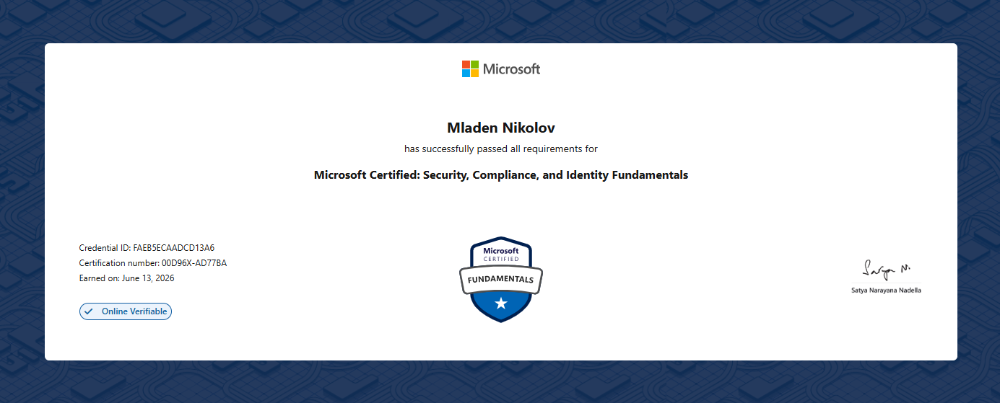

# SC-200 & SC-900

Got the credentials so now im aliagble to have an opinion about the certificates.

So...\
My final goal was to pass the <mark style="color:$warning;">SC-200:</mark> [<mark style="color:$warning;">Security Operations Analyst Associate</mark>](https://learn.microsoft.com/en-us/credentials/certifications/security-operations-analyst/) certificate from Microsoft. The game plan was to ket to know the basics of Azure from AZ-900, than to go through the material thats in the [<mark style="color:$warning;">SC-900 path</mark>](https://learn.microsoft.com/en-us/credentials/certifications/security-compliance-and-identity-fundamentals/?practice-assessment-type=certification), since it is heavy focused on entra id's function especially on the governance, compliance and regulations - and somewhat of those topics is also included in SC-200.

When finishing the SC-900 path decided i might as well try to get the cert and boost my confidience for SC-200.&#x20;

Op, corporate flex:

<figure><figcaption></figcaption></figure>

And than it was time for the final boss.

Bam. Another one in the bag:

<figure><figcaption></figcaption></figure>

#### Preparation Time

The preparation for the SC-900 was around 2,3 weeks. While to preparing for SC-200 took me like 2 months (studying alongide work and life), didn't want to start the exam until i feel completely comfortable, and i suggest you the same if you are thinging of taking it!!!

Also using only the microsoft learn path wont cut it (at least in my case), you need something additional like the [<mark style="color:$warning;">Pluralsight course</mark>](https://www.pluralsight.com/paths/microsoft-security-operations-analyst-sc-200) or go through [<mark style="color:$warning;">John Savill's</mark>](https://www.youtube.com/@NTFAQGuy/featured) videos or any other yt channel.

GL. \
Love.\
BataMladen :heart:

